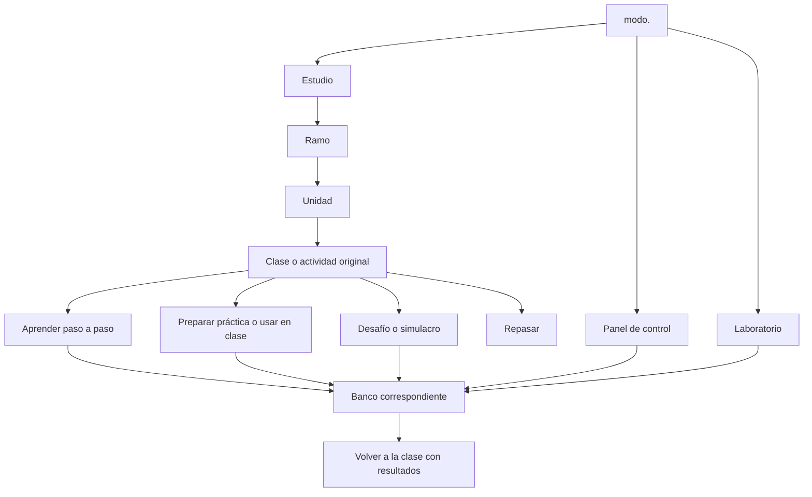

# Mapa de Estudio y formas de aprender en modo.

Propuesta del 17 de octubre de 2026. Define el contenido académico, las formas de usarlo y las herramientas necesarias. Es una planificación sobre el proyecto actual; las funciones propuestas todavía no están implementadas.

**Primera implementación posterior:** el usuario precisó integrar GeoGebra real. Se incorporó GeoGebra Classic al Laboratorio como herramienta libre y tres lecciones vinculadas a Estudio: constantes/lineales, cuadráticas y logaritmos, con 21 pasos en total. Cada lección abre desde la materia, guarda su archivo por separado y vuelve a Estudio. Esta entrega sustituye la idea de construir un motor de álgebra propio. Ver [entrega y verificación](../ENTREGA_GEOGEBRA_ESTUDIO.md). Los otros bancos y materias de este mapa siguen siendo planificación salvo las capacidades previas identificadas.

**Segunda implementación (entrega B del orden recomendado):** banco de temperatura con termocupla K/J, Pt100, multímetro y transmisor sobre el pizarrón del laboratorio, y las tres experiencias de la guía G03 como lecciones de Estudio. Ver [entrega y verificación](../ENTREGA_TEMPERATURA.md).

## 1. Organización general

Mantener tres accesos principales: **Estudio, Panel de control y Laboratorio**. Una clase puede abrir el banco que necesita y volver al mismo paso. Las distintas formas de aprender aparecen dentro del contexto correspondiente, evitando un inicio con muchas secciones nuevas.

| Espacio | Para qué sirve | Qué se conserva o añade |
|---|---|---|
| Estudio | Entender y repasar cada ramo, clase y actividad | Ampliar el catálogo académico y los recorridos visuales; conservar Protecciones y su progreso |
| Panel de control | Cablear, interpretar diagramas y operar el panel | Reutilizar panel, reconocimiento, lectura guiada, circuitos y comprobaciones existentes |
| Laboratorio | Montar, medir, programar y experimentar | Conservar esquemas, PLC, HMI, procesos y protoboard; añadir bancos de temperatura, detectores y fabricación |

Comunidad conserva su función actual de reconocimiento y acceso secundario. No se presupone una comunidad con chat o colaboración en tiempo real. Biblioteca, apuntes y progreso pertenecen al contexto de Estudio o de la práctica; no necesitan otros tres accesos principales.

El diagrama representa relaciones de producto, no rutas ya programadas. Compartir un banco no combina las clases ni sus respuestas.

## 2. Seis formas de aprender

| Forma | Qué hace el estudiante | Dónde aparece | Situación actual |
|---|---|---|---|
| Aprender paso a paso | Observa, predice, responde, actúa y recibe una explicación | En cada clase | Hay antecedentes en Protecciones y el panel; falta extenderlos al resto del material |
| Repasar | Recupera conceptos, resuelve preguntas y vuelve a errores concretos | Estudio, por clase/unidad/ramo | Existe en Protecciones; ampliar selección y seguimiento |
| Preparar la práctica | Reconoce equipos y herramientas, ensaya el montaje y comprueba resultados | En cada guía práctica | Nuevo recorrido común usando los bancos correspondientes |
| Usar en clase | Consulta un paso, un esquema o una animación; registra datos de sus equipos reales | En cada guía, accesible también desde el banco | Nuevo acompañamiento; no exige completar otra vez toda la teoría |
| Experimentar libremente | Construye, cambia valores y prueba una hipótesis fuera del guion | Panel y Laboratorio | Ya existe parcialmente; extenderlo al añadir bancos |
| Resolver un desafío | Trabaja con menos ayuda, diagnostica una falla o responde un simulacro | En la clase o banco compatible | Hay evaluaciones y comprobaciones parciales; falta una estructura común para las nuevas prácticas |

Preparar y usar en clase comparten el procedimiento, pero guardan resultados distintos. En preparación se anotan resultados simulados; en clase se registran mediciones reales introducidas por el estudiante. No se mezclarán ambos conjuntos ni se afirmará que el programa leyó un instrumento físico.

Los desafíos son prácticas y autoevaluaciones. No equivalen a una calificación oficial de INACAP. Las respuestas abiertas tendrán criterios y revisión propia; no se promete un corrector automático de cualquier razonamiento.

## 3. Qué llevará Estudio

### Inicio de Estudio

Seis ramos del aula actual, búsqueda, continuar la última clase y acceso al repaso. Cada ramo distingue fuentes recibidas, contenido interactivo preparado y resultados del estudiante. Los porcentajes del aula INACAP no se importan como progreso propio.

El catálogo del código contiene otros semestres, pero la entrega académica se limita al material recibido. Los demás ramos pueden figurar como catálogo futuro, sin clases inventadas ni apariencia de contenido completo.

### Dentro del ramo

Unidades plegables con clases, ejercicios, guías, evaluaciones y material de consulta. Cada recurso conserva su nombre y función. Las unidades sin fuentes se muestran pendientes. Si un archivo todavía no tiene ubicación exacta confirmada, queda como recurso por ubicar; no se asigna por intuición.

### Dentro de una clase

Objetivo concreto, requisitos previos, índice de bloques, fuente original y un paso principal visible. El recorrido incluye explicación visual, pregunta, acción cuando corresponda, resultado explicado y comprobación. Una clase conceptual puede usar clasificación, gráficos o interpretación sin forzar un montaje físico.

El estudiante puede retroceder, consultar el original, saltar a una sección y retomar. Consultar el PDF no acredita el aprendizaje de todos sus objetivos. Una adaptación añadida se distingue de una consigna del docente.

### Repaso de materia

- Selección por clase, unidad o ramo; mezcla entre ramos solo si el estudiante la elige.
- Resumen visual y mapa de conceptos, con enlace al bloque de origen.
- Preguntas breves, identificación de componentes, cálculos e interpretación de gráficos.
- Revisión de errores con explicación, ejemplo y nueva oportunidad.
- Ejercicios y simulacros vinculados al temario disponible.
- Registro de intentos y sugerencias basadas en errores o temas pendientes. La programación de repasos es una función propuesta, no una capacidad existente para todos los ramos.

El repaso refuerza lo estudiado. La clase completa y las experiencias de laboratorio mantienen sus recorridos y objetivos propios.

### Recursos de apoyo

Glosario con imágenes, fichas de componentes verificadas, material original, tablas de referencia, calculadoras del tema, apuntes, dudas y cuaderno de mediciones. Deben aparecer cuando ayudan al paso actual. No convertir la clase en un tablero de herramientas permanentemente abierto.

## 4. Mapa académico de los seis ramos

### Electrónica Aplicada a la Automatización

**U1 Principios de Electrónica y Electrónica Analógica:** conservar Clase 1 a Clase 5, Ejercicio 1 y Guía 1 del aula. Las fuentes cubren señales y componentes; diodos/LED; BJT/FET; puentes H con transistores y L293D; amplificadores operacionales, comparadores y acondicionamiento. Cada montaje, tabla, gráfico y conclusión debe quedar asociado a su actividad original.

La actividad de ajuste de cero/ganancia y la guía de AO conservan su identidad. No se da por confirmado que el archivo de ajuste sea el enlace «Ejercicio 1» de la captura. Los cuatro ejercicios de Guía 1 tampoco se convierten en una sola demostración.

**U2 Electrónica Digital y U3 Electrónica de Potencia:** estructura conocida por la captura; faltan fuentes suficientes para desarrollar sus clases. No extender los contenidos analógicos como sustituto.

Herramientas: protoboard, fuente, multímetro y gráficos existentes como base; AO y acondicionamiento requieren ampliar el modelo. Identificar terminales y límites con fichas concretas.

### Control de Máquinas Eléctricas Rotativas

**U1 Fundamentos:** actividades de máquinas CC serie/shunt/compound; experiencias trifásicas y monofásicas, conexiones, carga y mediciones. Conservar temario, rúbrica, resolución y referencia audiovisual como recursos diferenciados. El video está identificado, pero no se afirma una revisión completa de su contenido.

**U2 Control electromecánico:** Actividad 1 de arranque manual estrella–triángulo y clase de Protecciones. Vincular el panel que ya existe y las actividades de Protecciones. La variante temporizada conserva su identidad aparte del montaje manual solicitado.

**U3 Control electrónico de motores CA:** unidad reconocida; faltan materiales desarrollados.

Herramientas: reutilizar el panel resuelto. Las curvas de par/corriente/velocidad, dinamómetro, excitación y banco monofásico requieren modelos adicionales; el giro animado actual no proporciona esas mediciones.

### Instrumentación Industrial

**U1 Clasificación y características:** presentación del ramo, Conferencia 1 de fundamentos/clasificación y Conferencia 2 de cadena de medida/metrología. Mantener los dos ejercicios de diez lecturas, con referencia, promedio, sesgo y dispersión diferenciados.

**Recursos de consulta de variables:** caudal, presión, nivel y temperatura, cada conferencia independiente. Añadir explicaciones de principio, selección de sensor, lectura y comparación, indicando cuándo una práctica manipulable es adaptación nuestra.

**U2 Medición y actuación discreta/analógica:** Conferencia 2 de proximidad y las tres guías distintas recibidas:

| Guía | Experiencias que debe conservar | Banco |
|---|---|---|
| Detectores de presencia, G01 | Investigación/exposición; conectar, detectar, medir, graficar y comparar tipos/objetos | Detectores y multímetro |
| Proximidad y PLC, G02/G05 | Consultar cuatro modelos; medir y graficar; conectar sensor asignado al PLC y demostrar; conclusiones individuales | Detectores, fuente, multímetro y PLC |
| Temperatura, G03/G04 | Investigar RTD/termocupla; medir ambos y graficar a ambiente, 50, 75 y 100 °C; conectar termocupla a transmisor y obtener otra curva | Temperatura, instrumentos, transmisor y tablas |

Las ubicaciones finas dentro de U2 se conservarán según el aula cuando se confirme el índice completo. Dos guías llevan el número 2 y tienen temas diferentes: no deduplicarlas por el número. Los pares G02/G05 y G03/G04 sí son copias idénticas comprobadas.

El dibujo de temperatura distingue Pt100 en Ω y termocupla en mV. La experiencia del transmisor se refiere a la termocupla; 0–10 V es un ejemplo de salida y no fija por sí mismo el rango de temperatura. No añadir un PLC como requisito de esa guía ni inventar el bornero del Pt100.

**U3 Interpretación de instrumentación y control/P&ID:** conservar su lugar. Hay símbolos en las conferencias, pero faltan material completo, planos y actividades para tratar la unidad como desarrollada.

### Redes Industriales

**U1:** clase teórica, resumen con preguntas y Guía 1. Aprender codificaciones, errores y funciones OSI; fabricar el cable DB9–bornera, preparar extremos, soldar, medir continuidad, reparar y probar HMI–PLC con la configuración de la guía.

**U2 Medios/protocolos basados en Ethernet y U3 Implementación de redes:** estructura conocida, materiales pendientes.

Herramientas: banco de fabricación nuevo, visor de señales/bits nuevo y comunicación a desarrollar. El PLC/HMI actual comparte memoria interna; no se presenta como una implementación de RS485. Resolver las contradicciones del pinout docente antes de aceptar el cableado como correcto.

### Funciones y Matrices

**U1 Funciones polinómicas:** constantes/rectas/cuadráticas, actividades tecnológicas, problemas ARPA con sus extensiones y situaciones de modelación de servicio eléctrico, Sueño dorado y desabastecimiento. Conservar las preguntas y datos de cada fuente.

**U2 Exponenciales y logaritmos:** material recibido de logaritmos, GeoGebra y situación de seguidores. Falta completar las fuentes de exponenciales identificadas en el aula.

**U3 Trigonometría y U4 Sucesiones, vectores y matrices:** estructura reconocida en la captura; fuentes y actividades completas pendientes. No afirmar que tenemos desarrollada la parte de matrices por el nombre del ramo.

Herramientas: tabla y plano gráfico manipulables, puntos, funciones, comparación de modelos, cálculo y justificación. GeoGebra es un recurso externo identificado; un graficador propio sería un desarrollo nuevo. Las extensiones conservan sus respuestas y condiciones aparte del problema base.

### Administración

Ramo visible en el aula, sin documentos académicos recibidos. Reservar su tarjeta y marcar la falta de material. Casos, decisiones o cálculos podrán definirse al recibir clases y guías; no inventar una unidad oficial.

## 5. Bancos compartidos y trabajo necesario

| Banco o herramienta | Uso académico | Base actual | Ampliación propuesta |
|---|---|---|---|
| Panel de control | Máquinas, diagramas y protecciones | Panel, cableado, reconocimiento y guías existentes | Vinculación a cada clase y evidencia de su actividad; preservar lo resuelto |
| Electrónica en protoboard | Diodos, BJT, puentes H y AO | Componentes DC, medidor, presets y registro | Guiones y fichas; AO/acondicionamiento y parámetros adecuados al ejercicio |
| Temperatura | Guía Pt100/termocupla y conferencia | Sin banco térmico específico | Baño/horno, sondas, multímetro, transmisor, modelos y comparación de curvas |
| Detectores | G01, G02 y proximidad | Entradas PLC y lenguaje de cableado | Sensores concretos, objetos, fuente, topologías de salida, medición y conexión PLC |
| Fabricación de cables | Guía de Redes | Referencia visual del panel/protoboard | Cable, DB9, bornera, preparación, pelado, soldadura, defectos y continuidad |
| Comunicación industrial | Prueba de Redes | PLC y HMI con memoria interna | Modelo explícito de enlace, parámetros, intercambio y fallas; confirmar fidelidad necesaria |
| Procesos e instrumentos | Fundamentos, nivel, caudal, presión y metrología | Tanque con balance de volumen, bomba y umbrales | Instrumentos, presión, tecnologías de nivel/caudal y modelo de medida según la clase |
| Gráficos y señales | Matemáticas, metrología y teoría de Redes | Actividades y referencias externas como material | Componentes para curvas/tablas y visor de bits; no son un único modelo físico |
| Banco de máquinas con carga | Experiencias CC/trifásicas/monofásicas | Conexiones y representación del panel | Modelos de motor, excitación, carga, instrumentos y curvas documentadas |

Estos son bancos y herramientas dentro del sistema, no nueve aplicaciones ni nueve botones de inicio. Una nueva pieza necesita comportamiento y comprobaciones cuando el objetivo implique medir o diagnosticar; dibujarla no significa haberla simulado.

## 6. Qué incluye una práctica manual

Mantener la secuencia de la guía: objetivo → materiales/herramientas → procedimiento → comprobación → resultados → conclusión. El banco permite seleccionar, colocar, conectar y usar los elementos que exige ese procedimiento.

Ejemplos de acciones que deben tener efecto:

- En Redes, unir dos contactos o dejar un conductor abierto cambia la continuidad y la prueba posterior.
- En temperatura, elegir sensor y función de medida cambia la magnitud de lectura; cada dato queda asociado a temperatura y condiciones.
- En detectores, objeto, posición, alimentación y conexión afectan salida y entrada del PLC según el modelo verificado.
- En electrónica, conexión y valores cambian tensiones/corrientes dentro de los límites del modelo declarado.

Las operaciones de fabricación pueden modelarse por estados didácticos y defectos verificables. No se promete simular toda la física térmica de una soldadura. Los criterios de evaluación deben declarar qué aspecto de la operación comprueban.

## 7. Ejemplo completo de uso con el Pt100

1. Entrar en Estudio → Instrumentación → U2 → guía de temperatura, experiencia 2.
2. Ver objetivo, materiales y dibujo de las dos magnitudes; responder qué se va a medir en cada sensor.
3. Abrir la práctica preparada, escoger la sonda y ensayar los puntos pedidos.
4. Colocar puntas, seleccionar función del medidor y registrar valor/unidad/temperatura. Elegir una temperatura ambiente explícita en el escenario; no fijar un valor universal.
5. Construir curvas y contrastar con la referencia correspondiente al sensor y condiciones definidos.
6. En clase, abrir el mismo procedimiento y registrar en otro conjunto las mediciones reales.
7. Guardar observaciones y elaborar la comparación/conclusión. La exposición de experiencia 1 y la experiencia 3 con transmisor permanecen accesibles como actividades distintas.
8. Volver al repaso de los conceptos fallados o resolver una variante con menos ayuda, marcada como ampliación si la guía no la pide.

Este recorrido todavía requiere implementación y verificar modelos de los equipos, número de hilos, fichas, referencias y configuración del transmisor.

## 8. Información que debe acompañar cada actividad

Registrar ramo/unidad/material/experiencia/paso con identificadores estables; fuente y ubicación; objetivo; acción; banco; parámetros/unidades; criterio de comprobación; supuestos; resultados; notas y estado. Separar la fuente original, la adaptación pedagógica y el intento del estudiante.

Mantener estados distintos para **material recibido**, **adaptación preparada**, **funcionamiento comprobado** y **avance del estudiante**. El progreso puede registrar visto, intentado y comprobado por objetivo. No resumir esos estados con una única marca «hecho» al abrir un documento.

Al salir al laboratorio se conserva el contexto de la clase. El proyecto de práctica será una copia identificada y reiniciable; no sobrescribirá el trabajo libre. Los datos de estudio y proyectos actuales requieren una migración compatible antes de cambiar su almacenamiento. Guardado local y posibilidad de respaldo deben explicarse sin prometer sincronización entre dispositivos.

## 9. Orden de construcción recomendado

| Entrega | Resultado revisable | Criterio de cierre |
|---|---|---|
| A. Catálogo y navegación | Seis ramos, unidades y todos los recursos recibidos correctamente relacionados | No se pierden clases; fuentes pendientes visibles; Protecciones mantiene progreso y acceso |
| B. Primera práctica de temperatura | G03 experiencia 2 con guía visual, banco, tabla, gráfica y registro en clase | Recorrido completo ambiente/50/75/100 °C, magnitudes y referencias correctas; resultados simulados/reales separados |
| C. Completar la guía de temperatura y su repaso | Experiencias 1 y 3, conclusiones y preguntas vinculadas | No se confunde termocupla con Pt100 ni salida con rango; actividades conservadas |
| D. Detectores y PLC | G01 y G02 con los dispositivos documentados | Detección, medición y entrada PLC responden al montaje; conclusiones y gráficos incluidos |
| E. Taller de Redes | Fabricación y continuidad, seguida de comunicación | Topología y defectos cambian pruebas; pinout resuelto y alcance de comunicación declarado |
| F. Ampliación académica | Electrónica, Matemáticas, conferencias de Instrumentación y vínculos de Máquinas | Una adaptación revisada por fuente/actividad; no solo demostraciones sueltas |
| G. Desafíos e integración | Variantes, diagnóstico y proyectos entre ramos | Reutiliza bancos comprobados; mantiene identificables los objetivos de cada clase |

Este orden recomienda adelantar temperatura por la práctica actual del estudiante. Actualiza la prioridad anterior de construir primero el taller de Redes; no elimina ese taller. La elección concreta de equipos y referencias puede condicionar cada entrega. Las unidades sin documentos se completarán al recibir fuentes, fuera de cualquier promesa de cobertura inmediata.

## 10. Cobertura y pendientes

| Grupo de fuentes | Destino |
|---|---|
| F01–F08 | Electrónica: actividades, clases, guía y captura del índice |
| F09 | Estructura del aula de Instrumentación |
| F10–F18 | Máquinas: guías, referencia audiovisual, Protecciones, resolución, rúbrica, captura y temario |
| F19–F32 | Matemáticas: actividades, extensiones, enlaces, captura y modelaciones |
| F33–F36 | Redes: clase, guía, resumen y captura |
| I01–I08 | Programa y conferencias de Instrumentación |
| G01–G05 | Tres guías distintas de Instrumentación y sus dos copias duplicadas |
| Sin documentos | Administración y unidades/fuentes faltantes ya identificadas |

Conservar observaciones técnicas existentes antes de convertirlas en reglas automáticas: pinout de Redes; inconsistencias de la resolución de Máquinas; rango contradictorio en ejercicios de AO; errores conceptuales de las conferencias de Instrumentación; remisión ambigua de G03 a la guía 1. La fuente docente se conserva y la explicación corregida identifica su referencia.

## 11. Verificación al implementar

Comprobar cobertura de objetivos y consignas; modelos y resultados numéricos con referencias; interacción de montaje/medida y fallas; regreso a la clase; separación de mediciones reales/simuladas; persistencia y respaldo; teclado/táctil y móvil/escritorio. Ejecutar las comprobaciones del proyecto cuando se modifique el código. Una revisión documental no sustituye esas pruebas.

Fuentes del mapa: [inventario académico](INVENTARIO_COMENTADO.md), [análisis de Instrumentación](instrumentacion/ANALISIS_INSTRUMENTACION.md), [guías nuevas](guias-instrumentacion/ANALISIS_GUIAS.md), [matriz de prácticas por PDF](MATRIZ_PRACTICAS_TODAS_LAS_MATERIAS.md), [banco de Redes](PRACTICAS_VISUALES_REDES.md) y código actual de Home, HomeTools, catálogos de Estudio y modelo del Laboratorio. No se modificó la aplicación al preparar este mapa.
